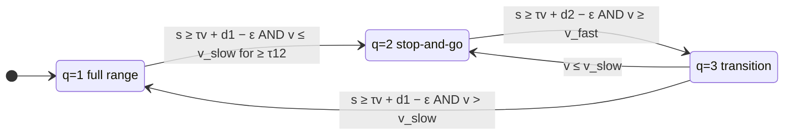

# multimodecbf

A ROS (catkin) package implementing a **multi-mode control barrier function (CBF)** safety supervisor for longitudinal vehicle control (adaptive cruise control). The node takes the acceleration requested by an untrusted nominal controller and modifies it when needed so that the ego vehicle keeps a safe space gap to the lead vehicle.

Unlike a single-mode CBF, which uses a fixed 15 m minimum space gap at every speed, the multi-mode CBF shrinks that margin to 5 m in slow, stop-and-go traffic. This allows higher vehicle density at low speeds. At higher speeds it restores the full margin.

This package was **auto-generated with Simulink Coder (ROS Toolbox)** from the Simulink model at:

> https://github.com/jmscslgroup/multimodecbf_simulink

Do not edit the generated C++ sources by hand. Make changes in the Simulink model and regenerate the package.

---

## How the CBF works

The method is described in [Sanborn et al., *Traffic Density with Multi-Mode Control Barrier Functions at Scale*](#citation).

### Single-mode CBF (background)

For an ego vehicle $n$ following a lead vehicle $n-1$, with space gap $s_n$ and ego velocity $v_n$:

$$\dot s_n = v_{n-1} - v_n = \Delta v_n, \qquad \dot v_n = u_n$$

The safety property requires the space gap to exceed a desired gap made of a time-gap term and a minimum distance:

$$h(x_n) = s_n - (\tau v_n + d^{\min}) \ge 0$$

From this property, the CBF control law is

$$u_{\text{cbf}}(x_n) = \frac{1}{\tau}\Big(k\big(s_n - (\tau v_n + d^{\min})\big) + \Delta v_n\Big)$$

The commanded acceleration is the more conservative of the CBF and nominal commands:

$$u_{\text{cmd}} = \min\{u_{\text{cbf}},\ k_{\text{nom}}\}$$

### Multi-mode CBF

The multi-mode CBF uses the same control law. The value of $d^{\min}$ and the maximum allowed acceleration change with the active mode $q$:

| Mode | Name | $d^{\min}$ | Accel. bound $u_n \in$ |
|---|---|---|---|
| $q=1$ | Full range (same as the single-mode CBF) | $d^{\min}_1 = 15$ m | $[-3.0,\ 1.5]$ m/s² |
| $q=2$ | Stop-and-go | $d^{\min}_2 = 5$ m | $[-3.0,\ 1.0]$ m/s² |
| $q=3$ | Transition | $d^{\min}_3(v_n)$ (below) | $[-3.0,\ 0.5]$ m/s² |

In the transition mode, the minimum gap blends smoothly between the two values as a sigmoid of ego velocity:

$$d^{\min}_3(v_n) = (d^{\min}_1 - d^{\min}_2)\,\frac{e^{k_d\left(v_n - \frac{v_{\text{slow}}+v_{\text{fast}}}{2}\right)}}{1 + e^{k_d\left(v_n - \frac{v_{\text{slow}}+v_{\text{fast}}}{2}\right)}} + d^{\min}_2$$

The lower acceleration limit in mode 3 lets the lead vehicle pull away, so the larger gap can be rebuilt before the controller returns to full-range mode.

#### Mode transitions



- **1 → 2:** the gap satisfies the full-range safety property, and the ego vehicle has been slow ($v_n \le v_{\text{slow}}$) for at least $\tau_{1,2}$ seconds.
- **2 → 3:** the ego vehicle speeds up ($v_n \ge v_{\text{fast}}$) while the gap satisfies the stop-and-go safety property.
- **3 → 1:** the gap has grown enough to satisfy the full-range safety property again (and $v_n > v_{\text{slow}}$).
- **3 → 2:** the ego vehicle slows back down ($v_n \le v_{\text{slow}}$). This check takes priority over 3 → 1.

The node always starts in mode 1.

### Constants (hard-coded in the model)

| Constant | Value | Meaning |
|---|---|---|
| $\tau$ | 2.0 s | Desired time gap |
| $k$ | 0.1 | CBF gain |
| $d^{\min}_1$ | 15.0 m | Minimum gap, full-range mode |
| $d^{\min}_2$ | 5.0 m | Minimum gap, stop-and-go mode |
| $k_d$ | 3.0 | Sigmoid gain for $d^{\min}_3$ |
| $v_{\text{slow}}$ | 5.0 m/s | Low-speed threshold |
| $v_{\text{fast}}$ | 7.5 m/s | High-speed threshold |
| $\epsilon$ | 0.1 m | Transition buffer |
| $\tau_{1,2}$ | 3.0 s | Time spent slow before entering stop-and-go (60 steps at 20 Hz) |
| $u^{\min}$ | −3.0 m/s² | Minimum commanded acceleration |
| $u^{\max}_{1,2,3}$ | 1.5 / 1.0 / 0.5 m/s² | Maximum acceleration per mode |

### Node output pipeline

At every step (20 Hz, 0.05 s), the node does the following:

1. It updates the mode state machine from `lead_dist` and `car/state/vel_x`.
2. It computes $u_{\text{cbf}}$ with the mode's $d^{\min}$, using `rel_vel` as $\Delta v_n$, and clamps it to the mode's $u^{\max}_q$. This value is published on `multimodecbf_debug/cbf_acc`.
3. **Creep hold (an addition beyond the paper):** if the ego velocity is ≤ `creep_velocity_limit` and the clamped CBF acceleration is ≤ `creep_acceleration_limit`, the node forces a command of −1.0 m/s². This holds the vehicle still instead of letting it creep forward at near-zero speed.
4. It takes the minimum of the CBF acceleration, the nominal command `cmd_accel_pre`, and the creep-hold value, then saturates it below at −3.0 m/s². This result is published on `cmd_accel`.

---

## ROS interface

Node name (default): `multimodecbf`. All messages are from `std_msgs`.

### Subscribed topics

| Topic | Type | Description |
|---|---|---|
| `lead_dist` | `std_msgs/Float64` | Space gap to the lead vehicle, $s_n$ (m) |
| `car/state/vel_x` | `std_msgs/Float64` | Ego longitudinal velocity, $v_n$ (m/s) |
| `rel_vel` | `std_msgs/Float64` | Relative velocity $\Delta v_n = v_{n-1} - v_n$ (m/s) |
| `cmd_accel_pre` | `std_msgs/Float64` | Acceleration requested by the nominal (untrusted) controller, $k_{\text{nom}}$ (m/s²) |

### Published topics

| Topic | Type | Description |
|---|---|---|
| `cmd_accel` | `std_msgs/Float64` | Safe commanded acceleration sent to the vehicle (m/s²) |
| `multimodecbf_debug/cbf_acc` | `std_msgs/Float64` | CBF acceleration $u_{\text{cbf}}$ after clamping to the mode's $u^{\max}_q$ (m/s²) |
| `multimodecbf_debug/cbf_mode` | `std_msgs/Int8` | Active mode: `1` = full range, `2` = stop-and-go, `3` = transition |
| `multimodecbf_debug/cbf_active` | `std_msgs/Int8` | `1` if `cmd_accel` differs from `cmd_accel_pre` (the CBF modified the nominal command), else `0` |

Queue sizes are 1 for all topics. Before a topic has received its first message, its input is treated as 0.

### Parameters

| Parameter | Type | Default | Description |
|---|---|---|---|
| `creep_velocity_limit` | double | `0.1` | Ego velocity (m/s) at or below which creep hold may engage |
| `creep_acceleration_limit` | double | `0.0` | CBF acceleration (m/s²) at or below which creep hold engages when the vehicle is below `creep_velocity_limit` |

The node reads the parameters every step, so you can change them at runtime with `rosparam set`. They are resolved with the node's **public** `NodeHandle`, which means they are relative to the node's namespace and are not private (`~`) parameters. A `<param>` nested inside a `<node>` tag in a launch file creates a private parameter (`/<node_name>/creep_velocity_limit`), which this node does **not** read. Set the parameters at the namespace level instead, or push the node into a namespace with `<group ns="...">`.

---

## Building and running

This is a ROS 1 catkin package that depends on `roscpp` and `std_msgs`.

```bash
cd ~/catkin_ws
catkin_make            # or: catkin build multimodecbf
source devel/setup.bash
rosrun multimodecbf multimodecbf
```

Remap topics as needed for your vehicle stack, e.g.:

```bash
rosrun multimodecbf multimodecbf cmd_accel:=new_cmd_accel lead_dist:=lead_dist_extra
```


---

## Related resources

- Simulink source model: https://github.com/jmscslgroup/multimodecbf_simulink
- Traffic-scale simulations and plots from the paper: https://github.com/jmscslgroup/multi-mode_cbf_simulation

## Citation

To cite the usage of this repository, use the following:

> Kate Sanborn, George Gunter, Daniel B. Work, Ricardo G. Sanfelice, Jonathan Sprinkle. "Traffic Density with Multi-Mode Control Barrier Functions at Scale." in 2026 IEEE International Conference on Intelligent Transportation Systems (ITSC), (in press) 2026.

or using bibtex:

```
@inproceedings{sanborn2026single,
  author    = {Sanborn, Kate and Gunter, George and Work, Daniel B. and Sanfelice, Ricardo G. and Sprinkle, Jonathan},
  title      = {Traffic Density with Multi-Mode Control Barrier Functions at Scale},
  booktitle  = {2026 IEEE International Conference on Intelligent Transportation Systems (ITSC)},
  year       = {2026},
  note       = {in press}
}
```

The single-mode CBF this work builds on:

> G. Gunter, M. W. Nice, M. Bunting, J. Sprinkle, and D. B. Work, "Can control barrier functions keep automated vehicles safe in live freeway traffic?," in *2025 ACM/IEEE 15th International Conference on Cyber-Physical Systems (ICCPS)*, 2025.
